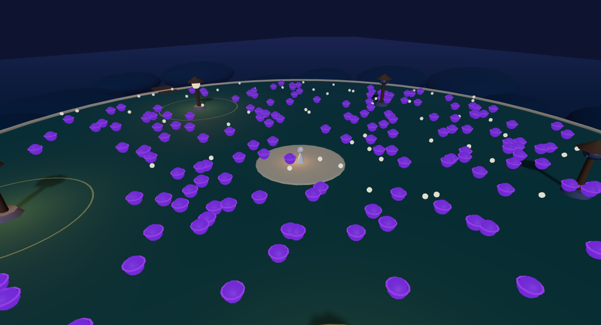

# Đảo Đèn Lồng — v1.0.0 (Day 12 AI SDLC)

> **Video demo (< 5 phút):** [Xem / tải `demo.mp4` tại GitHub Release `v1.0.0`](https://github.com/quangtrung0812/K5-L3A-DAY12-NguyenQuangTrung-2A202603389-AI-SDLC/releases/tag/v1.0.0) *(file `demo.mp4` và bản chạy web `dao-den-long-v1.0.0-web.zip` được đính kèm công khai trong Release `v1.0.0`)*



Game phiêu lưu hành động 3D góc nhìn thứ ba: điều khiển **Mây** vượt qua chiến dịch **3 Đêm** (*Đêm 1: Đảo Bến*, *Đêm 2: Đảo Cau*, *Đêm 3: Đảo Chuông*), thu thập **đom đóm**, thắp sáng và châm dầu giữ **Đèn Lồng Lớn** sáng tới bình minh, né **Bóng Mực** hút dầu và đối phó với **Gió Lạc**.

- **Tác giả:** Nguyễn Quang Trung (`2A202603389`)
- **Phiên bản phát hành:** `v1.0.0` (Phase 4 · **Test Contract v1.3** · Giấy phép [`MIT`](LICENSE))
- **Tags đầy đủ:** `phase-1` · `phase-2` · `phase-3` · `phase-4` · Release `v1.0.0`

---

## Yêu cầu hệ thống

- **Hệ điều hành:** Windows 10/11, macOS hoặc Linux
- **Node.js:** `>= 18` (đã kiểm chứng thực tế trên `v24.18.1`)
- **Trình duyệt:** Chrome, Edge, Firefox hoặc Safari có WebGL2 *(chế độ benchmark tự động `bench_cmd` dùng Chrome/Chromium/Edge cài sẵn trên máy hoặc biến môi trường `BENCH_BROWSER`)*

---

## Cài đặt & Chạy (tối đa 3 lệnh)

Từ bản clone sạch của repo:

```bash
npm install
npm run build
node scripts/run.mjs
```

Mở trình duyệt tại **`http://localhost:4173`** để chơi game (lưu sẵn Bảng xếp hạng cục bộ vào `~/.dao-den-long/leaderboard.json`).

---

## Điều khiển & Trợ năng (Accessibility)

Mọi phím dưới đây đều **đổi được tùy ý** trong **Cài đặt & Trợ năng** (tự phát hiện trùng phím, có nút **Khôi phục mặc định**, tự lưu vào trình duyệt):

| Phím mặc định | Hành động |
|---|---|
| `W` `A` `S` `D` (hoặc `↑` `↓` `←` `→`) | Di chuyển Mây (`6.0 m/s`, `7.2 m/s` khi có Bùa Gió) |
| `Space` | Nhảy (`7.0 m/s`, trọng lực `-20 m/s²`) |
| `Shift` | **Lướt (Dash)** — `14 m/s` trong `0.2s` (12 tick), hồi chiêu `1.5s` (`0s` khi có Bùa Gió) |
| `E` (hoặc `F`) | Tương tác đèn (`2.0m`): nạp thắp mới (`10`), thắp lại (`5`), hoặc **châm dầu** (`+10` dầu/đom đóm) |
| `Q` | **Tỏa Sáng (Pulse)** — tốn `3` đom đóm, bán kính 3D `5m`, đẩy `4m` & choáng `2s` (`+5` điểm; `+15` nếu Bóng Mực đang `drain`) |
| Di chuyển chuột / Cuộn chuột / `J` `L` | Xoay camera 3D tự do (nhấp để khóa chuột 360°) & zoom mượt (`2.6m–24m`) |
| `P` (hoặc `Esc`) | Tạm dừng (`paused` — đóng băng hoàn toàn thời gian, dầu đèn và AI) |

### Tính năng Dễ tiếp cận (Phase 4)
- **Đổi phím toàn bộ 9 hành động:** 4 hướng di chuyển, Nhảy, Lướt, Tương tác, Tỏa Sáng, Tạm dừng; báo lỗi trùng phím & nút **Khôi phục mặc định**.
- **Phụ đề & chỉ báo hình ảnh thời gian thực:** Bóng Mực xuất hiện (kèm **mũi tên chỉ hướng ở mép màn hình**), gió mạnh sắp thổi, đếm ngược `10 s` cuối, và cảnh báo đèn yếu dầu (`fuel < 30`).
- **Chế độ mù màu ("Bảng màu dễ phân biệt"):** Viền & mắt Bóng Mực đổi sang `#00B3FF`, cảnh báo đổi sang `#FFFFFF` kèm biểu tượng `⚠`; đèn tắt luôn xẹp `20%` kèm vết rách giấy.
- **Giảm chuyển động:** Tắt toàn bộ rung camera, FOV giật, bước chạy nảy và hiệu ứng chớp màn hình.
- **Cỡ chữ giao diện:** Tối thiểu **`18 px`** ở `1280×720`, có tùy chọn **Chữ lớn (`×1.25` = `22.5 px`)**.

---

## Bảng xếp hạng cục bộ

- Cho phép nhập tên (`3–12` ký tự `[A-Za-z0-9_]`, **hỗ trợ đầy đủ tiếng Việt có dấu**) sau khi thắng Đêm 3 (Bình Minh) hoặc sau khi thua ở bất kỳ Đêm nào.
- Lưu **Top 10** trên đĩa cục bộ (`~/.dao-den-long/leaderboard.json`, bền vững sau khi tắt/mở lại game), sắp xếp theo `score` giảm dần (bằng điểm ai đạt trước đứng trên).
- Xem trực tiếp từ nút **Bảng xếp hạng** trên Menu chính, hoặc xuất JSON qua CLI:

```bash
node scripts/run.mjs --export-leaderboard out.json
```

---

## Kiểm thử, Headless, Benchmark & Soak Test (Test Contract v1.3)

Tất cả hằng số và lệnh được khai báo chuẩn trong [`game.contract.json`](game.contract.json) (`contract_version: "1.3"`):

### 1. Chạy toàn bộ bộ kiểm chứng tự động
```bash
npm test
```
*(Chạy `tsc --noEmit` + `build:headless` + `19` unit tests + `23` kiểm tra Contract v1.3: regression Phase 1–2, tính năng Phase 3, SHA-256 3 Đêm, hiệu năng 18.000 tick Đêm 3, mã thoát `2`, soak test 10 Đêm và `--export-leaderboard`.)*

### 2. Chế độ Headless CLI (Đêm 1 / 2 / 3)
```bash
node dist/headless/headless/cli.js --seed 42 --night 1 --ticks 600 --snapshot-every 10 --out tmp/out.jsonl
node dist/headless/headless/cli.js --seed 42 --night 2 --ticks 1200 --snapshot-every 20 --out tmp/n2.jsonl
node dist/headless/headless/cli.js --seed 42 --night 3 --ticks 18000 --snapshot-every 60 --out tmp/n3.jsonl
```

### 3. Benchmark 3D chuẩn 1280×720 (`bench.json`)
```bash
node scripts/bench.mjs --seed 42 --duration 30 --out bench.json
```
- Mở cửa sổ `1280×720` không toàn màn hình, tắt VSync bằng cờ Chromium `--disable-frame-rate-limit --disable-gpu-vsync` (`vsync_off: true`), tải cảnh chuẩn Đêm 1 (`200` Bóng Mực `wander` + `100` đom đóm + `L1–L3` sáng `fuel=100`, tắt toàn bộ hiệu ứng sáng tạo thêm), camera bay vòng `r = 30m, Y = 15m` (`15s/vòng` CCW), khởi động `3s` + đo `30s`.
- **Kết quả tự đo thật ([`bench.json`](bench.json)) trên Intel Core i7-11800H / Intel UHD Graphics / Windows 11:**
  - `avg_fps`: **`152.3` FPS** (ngưỡng `≥ 60`)
  - `p1_low_fps`: **`54.8` FPS** (ngưỡng `≥ 30`)
  - `frame_ms_p95`: **`11.3` ms** · `frames`: **`4570`**
  - `load_ms`: **`2203` ms** (ngưỡng `≤ 10000`) · `peak_mem_mb`: **`741.4` MB**

### 4. Soak test 10 Đêm liên tiếp (`soak.json`)
```bash
node --max-semi-space-size=1 --expose-gc dist/headless/headless/soak.js --seed 7 --nights 10 --out soak.json
```
- **Kết quả tự đo thật ([`soak.json`](soak.json)):** `nights: 10`, `crashes: 0`, `mem_start_mb: 49.4 MB` → `mem_end_mb: 55.2 MB` (**`1.12×`** ≤ ngưỡng `1.20×`), `duration_s: 0.32 s`.

### 5. Đóng gói bản phát hành `v1.0.0`
```bash
npm run package:release
```
Tạo gói chạy độc lập `tmp/dao-den-long-v1.0.0-web.zip` (gồm `dist/`, `scripts/run.mjs`, `scripts/bench.mjs`, `game.contract.json`, `README.md`, `LICENSE`, `CREDITS.md`, `CHANGELOG.md`).

---

## Sáng tạo của tôi

Toàn bộ chi tiết sáng tạo chỉ chạy ở tầng client (`src/client/`), **tắt hoàn toàn trong Headless, Benchmark (`benchMode`) và Soak test**, không làm đổi bất kỳ luật, số liệu hay byte đầu ra nào của Test Contract v1.3:

1. **Nhân vật Mây phong cách Chibi Kiếm Sĩ Nón Trắng (Scarlet) & Bóng Mực chibi Doro (`src/client/scene.ts`):** Mây được dựng thủ tục 100% với nón lá cơ khí trắng viền đỏ `#C8102E`, áo haori trắng lót đỏ, giáp vai samurai xếp tầng, kiếm chuôi trắng và đèn lồng mini đeo hông kèm **cuộn chuột zoom mượt** (`2.6m–24m`); Bóng Mực có tạo hình chibi 4 chân **Doro** với 6 trạng thái hoạt họa trực quan (`spawning`, `wander`, `chase`, `recoil`, `stunned`, `drain`); Gió Lạc có 2 hình dạng (*Hạc Lụa*, *Hồ Ly Lụa*).
2. **La bàn Đom Đóm Dẫn Đường & Hiệu ứng hút ánh sáng (`src/client/scene.ts`):** Mũi tên vàng xoay quanh chân Mây, mũi tên viền màn hình chỉ đèn cần thắp/châm dầu, đom đóm nghiêng vỗ cánh về phía Mây ở tầng hiển thị (giữ nguyên `pickup_radius = 1m` trong lõi), lá vàng bay báo trước gió mạnh 2 giây và biển mây trôi quanh 3 hòn đảo.
3. **Nhạc đêm & 18 âm thanh ngũ cung thủ tục Web Audio API (`src/client/audio.ts`):** Tổng hợp 100% thời gian thực không dùng file âm thanh bên ngoài.

**Bằng chứng phần lõi & benchmark không bị ảnh hưởng:** `tsconfig.headless.json` chỉ biên dịch `src/sim/` + `src/headless/` (không import `src/client/`); `benchMode: true` sử dụng riêng Mây chuẩn & `InstancedMesh` tối giản; toàn bộ `19/19` unit tests + `23/23` kiểm tra Contract v1.3 đều **PASS** ([`docs/proof/phase-4/contract-report.md`](docs/proof/phase-4/contract-report.md)).

---

## Hồ sơ SDLC, Harness AI, Bản quyền & Bằng chứng

- **Pháp lý & Nguồn gốc:** [`LICENSE`](LICENSE) (MIT) · [`CREDITS.md`](CREDITS.md) · [`CHANGELOG.md`](CHANGELOG.md) (đủ 4 Phase)
- **Harness AI:** [`AGENTS.md`](AGENTS.md) · Skill [`.agents/skills/verify-phase/SKILL.md`](.agents/skills/verify-phase/SKILL.md) · Hook [`.githooks/pre-push`](.githooks/pre-push) · CI [`.github/workflows/verify.yml`](.github/workflows/verify.yml)
- **Ghi chép, Giả định, Nhật ký AI & Retro:** [Phase 1](docs/notes/phase-1-assumptions.md) · [Phase 2](docs/notes/phase-2-spec.md) · [ADR-001 (Phase 3)](docs/notes/adr-001-lantern-fuel-and-dawn-win.md) · [Nhật ký AI & Token](docs/notes/ai-log.md) · [**Retrospective cả 4 Phase**](docs/notes/retro.md)
- **Bằng chứng kiểm chứng theo Tag:** [Phase 1](docs/proof/phase-1/README.md) · [Phase 2](docs/proof/phase-2/README.md) · [Phase 3](docs/proof/phase-3/README.md) · [**Phase 4 (`v1.0.0`)**](docs/proof/phase-4/README.md) · [Báo cáo Contract v1.3](docs/proof/phase-4/contract-report.md) · [`bench.json`](bench.json) · [`soak.json`](soak.json)
